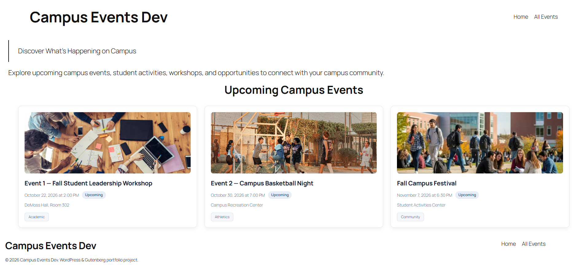
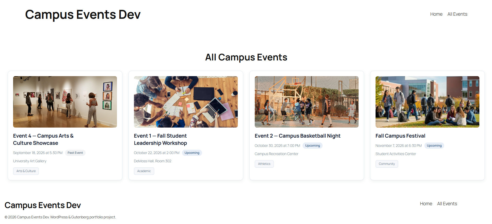
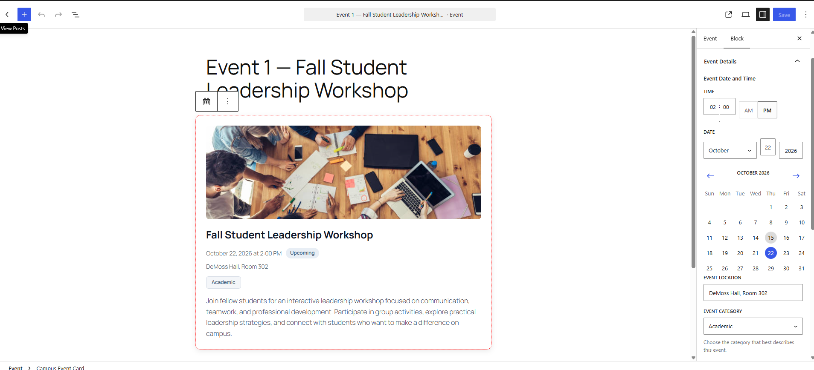
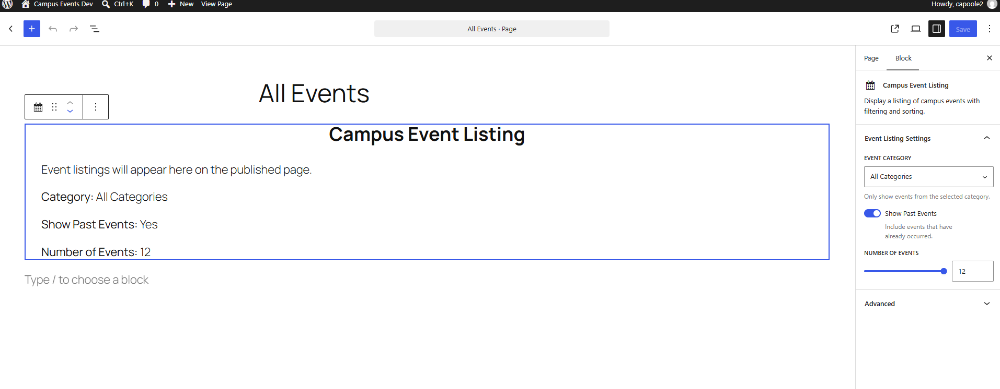

# WordPress Gutenberg Events

A custom WordPress event management plugin built using **React, JavaScript, PHP, and CSS/SCSS**, featuring two Gutenberg blocks and a dynamic event listing system.

This project was developed as a portfolio demonstration of WordPress plugin development, custom Gutenberg blocks, front-end styling, and integration with WordPress's content management system.

## Overview

WordPress Gutenberg Events allows website administrators to create, manage, and display campus events using the WordPress block editor.

The plugin includes two custom Gutenberg blocks:

- **Campus Event Card** — An individually configurable event card.
- **Campus Event Listing** — A dynamic listing that automatically retrieves published campus events.

A demonstration website was also created using WordPress's Site Editor, featuring a homepage, event listings, and navigation.

## Features

### Campus Event Card

- Editable event titles and descriptions
- Event date and time selection
- Event location and category settings
- Optional event registration links
- Event image support
- Automatic event status indicators (Upcoming, Today, Past Event)
- Custom Gutenberg editor controls
- Responsive card styling

### Campus Event Listing

- Automatically retrieves published campus events
- Uses a custom WordPress post type for event management
- Displays featured images, titles, dates, locations, and categories
- Sorts events chronologically
- Automatically calculates event status
- Filters events by category
- Option to include or exclude past events
- Configurable number of displayed events (1–12)
- Responsive event card layout
- Links to individual event pages

### Demonstration Website

A local WordPress demonstration website was created with:

- Homepage featuring upcoming campus events
- All Events page displaying upcoming and past events
- Header and footer navigation
- Custom homepage layout and styling
- Sample events for testing different categories and dates

**Note:** The demonstration website's pages, navigation, and Site Editor templates are stored in the local WordPress database and are not included in this repository.

## Technologies Used

| Technology | Purpose |
|---|---|
| WordPress | Content management and plugin platform |
| Gutenberg Block Editor | Custom block integration |
| JavaScript / React | Interactive block editor functionality |
| PHP | Plugin registration, custom post types, and server-side rendering |
| HTML | Event card structure and markup |
| SCSS / CSS | Responsive styling and presentation |
| Node.js / npm | Development dependencies and asset compilation |
| Git / GitHub | Source control and project management |

## Getting Started

### Requirements

- A local or hosted WordPress installation
- Node.js and npm
- A development environment capable of running WordPress and PHP

### Installation

1. Clone this repository.
2. Navigate to the `campus-event-card` directory.
3. Install dependencies:

   `npm install`

4. Compile the Gutenberg blocks:

   `npm run build`

5. Copy or link the `campus-event-card` directory into your WordPress installation's `wp-content/plugins/` directory.
6. Activate the plugin through **WordPress Admin → Plugins**.

### Using the Plugin

**Creating an Event**

1. Navigate to **Campus Events → Add New** in WordPress.
2. Enter the event title and content.
3. Configure the event date, location, and category.
4. Optionally add a featured image.
5. Publish the event.

**Displaying Events**

1. Open a page in the Gutenberg editor.
2. Insert the **Campus Event Listing** block.
3. Configure the block settings:
   - Event category
   - Show or hide past events
   - Number of events to display
4. Publish or update the page.

The listing automatically displays matching published events.

The **Campus Event Card** block can also be inserted independently to create individually configured event cards.

### Development

To automatically rebuild the plugin when source files change:

`npm start`

To generate a production build:

`npm run build`

## Project Structure

```text
wordpress-gutenberg-events/
├── README.md
└── campus-event-card/
    ├── campus-event-card.php
    ├── package.json
    ├── src/
    │   ├── campus-event-card/
    │   └── campus-event-listing/
    └── build/
        ├── blocks-manifest.php
        ├── campus-event-card/
        └── campus-event-listing/
```

- `src/` — Gutenberg block source code
- `build/` — Compiled assets used by WordPress
- `campus-event-card.php` — Main plugin file, block registration, and custom post type configuration
- `package.json` — Dependencies and build scripts


## Screenshots

### Homepage
The homepage displays upcoming campus events automatically.



### All Events Page
Displays published events, including upcoming and past events.



### Campus Event Card Editor
A custom Gutenberg block with editable event information.



### Event Listing Settings
Gutenberg sidebar controls for filtering categories, showing past events, and selecting the number of events.




## Potential Future Improvements

The project is complete for its initial portfolio scope. Possible future enhancements include:

- Visitor-facing event filters
- Event search functionality
- Pagination for larger event collections
- Additional customization and accessibility improvements

## Project Status

**Complete — Portfolio Demonstration**

The core plugin and demonstration website have been developed and tested in a local WordPress environment.

The project demonstrates practical experience with custom Gutenberg blocks, React-based editor controls, WordPress custom post types, PHP server-side rendering, and responsive front-end development.